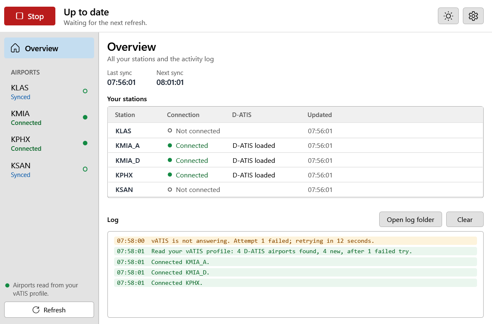
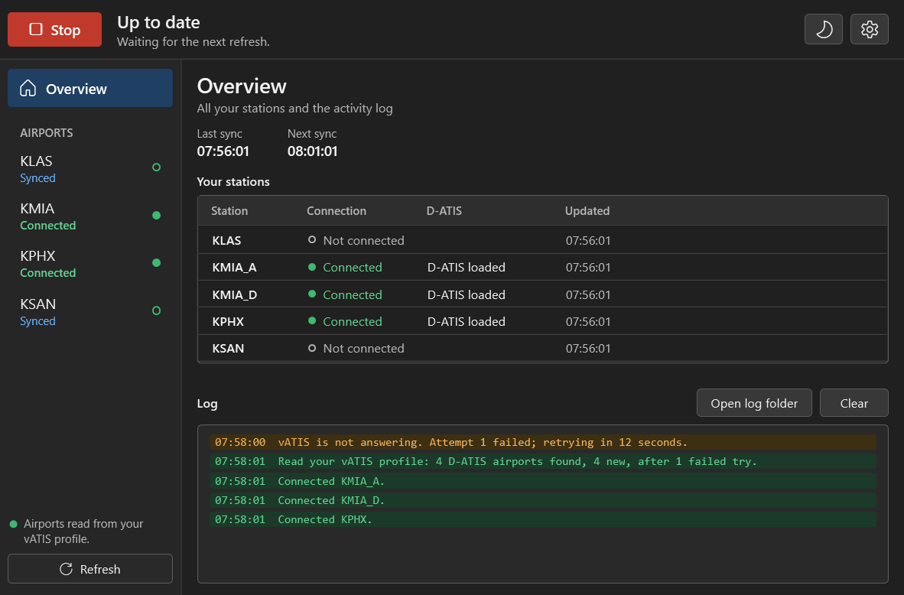
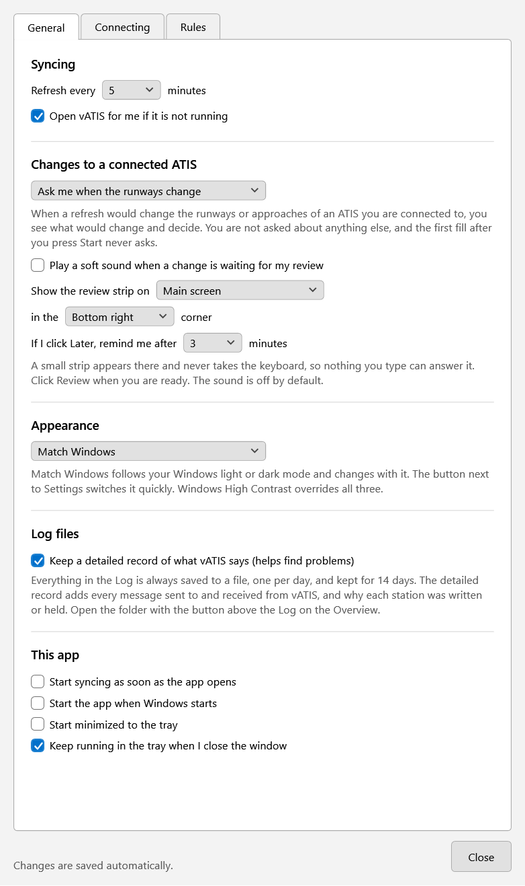

# Appearance

The app can be light or dark, and by default it follows Windows.

- [Choosing](#choosing)
- [The quick switch](#the-quick-switch)
- [Windows High Contrast](#windows-high-contrast)
- [What follows the theme](#what-follows-the-theme)
- [Limits](#limits)

| Light | Dark |
|---|---|
|  |  |

## Choosing

Under **Settings**, in **Appearance**:

| Choice | What it does |
|---|---|
| **Match Windows** (the default) | Uses Windows' own light or dark mode for apps (Windows Settings, Personalization, Colors), and changes with it while the app is open. |
| **Light** | Always light. |
| **Dark** | Always dark. |

The choice is saved and applied the moment you change it. Nothing needs a restart, and a sync in progress is not affected.

## The quick switch

The button beside **Settings** at the top of the window shows what is showing now: a sun for light, a moon for dark.
Click it for the three choices, with a tick on the current one. Hover over it to see the setting in words, for example
`Appearance: Match Windows (now dark)`.

## Windows High Contrast

If Windows High Contrast is on, the app uses your Windows colors whatever you chose here, because you turned it on for
a reason. The quick switch is greyed out while it is on, and its tooltip says so. Turn High Contrast off and your choice
applies again.

## What follows the theme

Everything the app draws: the main window, Settings, the approval question, buttons, menus (the airport right-click
menu and the tray menu), tooltips, scroll bars, and the colored status words and highlights. The window title bars
follow too.

The colors keep their meaning in both themes: green for in step and written, amber for a warning or a disregarded
change, red for an error or removed text. In dark they are lighter, so they read against the dark background; every
text and background pair in the dark colors is checked for contrast, and the check runs with the tests.

## Limits

- **Title bars need a recent Windows.** Windows draws them, and dark title bars exist on Windows 10 (version 1903 and
  later) and Windows 11. On anything older the title bar stays light; nothing else changes.
- **Windows notifications are Windows'.** The one notification the app sends (the first time it hides to the tray, to
  say it is still running) follows Windows' own theme, not this setting.
